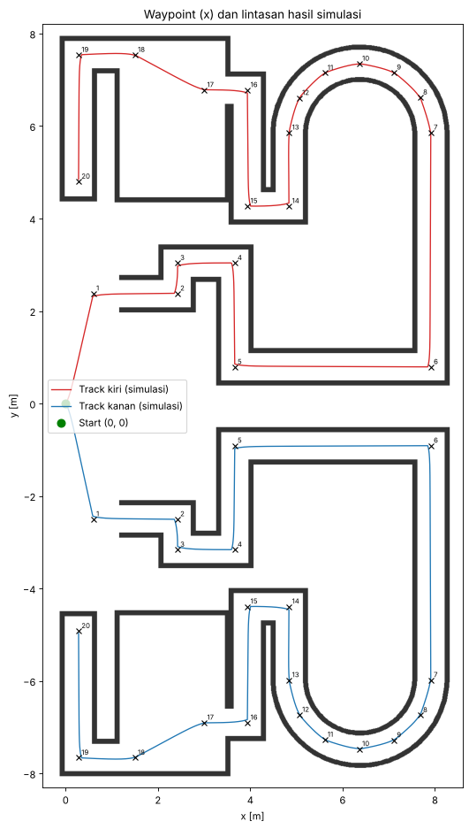

# UTS Robotika – Node Penggerak Robot Robin

Node ROS2 (Python) yang membawa robot **robin** dari titik start (0, 0) melewati track UTS sampai kotak finish, lalu mencetak **waktu tempuh**. Bisa memilih track **kiri** atau **kanan**.

Robot **tidak membaca data Gazebo** (pose atau tf). Node hanya memakai dua topic yang diizinkan:

| Topic | Tipe | Dipakai untuk |
| --- | --- | --- |
| `/wheel/speed` | `std_msgs/Float64MultiArray` | Membaca φ̇L = `data[0]`, φ̇R = `data[1]` (rad/s) |
| `/cmd_vel` | `geometry_msgs/Twist` | Mengirim VB (`linear.x`) dan ω (`angular.z`) |



## Cara kerja (bahan penjelasan di video)

1. **Forward kinematics**: VB = r/2 (φ̇L + φ̇R), ω = r/s (−φ̇L + φ̇R)
2. **Global coordinate**: ẋ = VB cos θ, ẏ = VB sin θ, θ̇ = ω
3. **Position estimation (odometri)**: x_k = x_(k−1) + ẋ·Δt (begitu juga y dan θ). Posisi robot dihitung sendiri dari kecepatan roda.
4. **Go-to-goal** ke 20 waypoint di tengah lorong:
   - d = √(Δx² + Δy²), θd = atan2(Δy, Δx), eθ = atan2(sin(θd − θ), cos(θd − θ))
   - VB = Kv·d, ω = Kθ·eθ
   - Kalau |eθ| besar, robot putar di tempat dulu.
5. Saat d ≤ εp di waypoint terakhir, robot berhenti dan waktu tempuh dicetak.

Nilai roda yang dipakai: **r = 0,03 m, s = 0,17 m** (ukuran fisik robot di `mobile_base.xacro`). Plugin DiffDrive di Gazebo memakai r = 0,1 m dan s = 0,45 m. Akibatnya robot bergerak lebih lambat dari perintah, tetapi odometri tetap benar karena dihitung dari putaran roda yang sebenarnya.

## Langkah 1 – Siapkan simulasi branch `uts` (sesuai Notion)

```bash
cd ~/ros2_ws/src/robin_bringup && git fetch && git switch uts
cd ~/ros2_ws/src/robin_description && git fetch && git switch uts
```

## Langkah 2 – Pasang package ini

Salin folder `uts_robot` ke `~/ros2_ws/src/`, lalu build:

```bash
cd ~/ros2_ws
colcon build --packages-select uts_robot robin_bringup robin_description
source ~/.bashrc
```

## Langkah 3 – Jalankan

Terminal 1 (simulasi):

```bash
ros2 launch robin_bringup my_robot_gazebo.launch.py
```

Terminal 2 (node UTS), pilih salah satu:

```bash
ros2 run uts_robot uts_node --ros-args -p track:=kiri -p use_sim_time:=true
ros2 run uts_robot uts_node --ros-args -p track:=kanan -p use_sim_time:=true
```

Di akhir, terminal menampilkan:

```
FINISH! Track KIRI
Waktu tempuh : xxx.xx detik
```

**Sebelum mencoba ulang:** hentikan node (Ctrl+C), kembalikan robot ke start, lalu jalankan node lagi. Odometri selalu mulai dari (0, 0).

```bash
gz service -s /world/empty/set_pose --reqtype gz.msgs.Pose --reptype gz.msgs.Boolean --timeout 3000 --req 'name: "robin", position: {x: 0, y: 0, z: 0}, orientation: {x: 0, y: 0, z: 0, w: 1}'
```

**Kenapa `use_sim_time:=true`?** Odometri mengalikan kecepatan dengan Δt. Kalau Gazebo berjalan lebih lambat dari waktu nyata (Real Time Factor < 100%, sering terjadi saat merekam layar), Δt dari jam komputer jadi terlalu besar dan posisi meleset. Dengan opsi ini node memakai waktu simulasi dari `/clock`, yang hanya berisi waktu, bukan posisi. Kalau dosen tidak mengizinkan, hapus opsi itu dan pastikan Real Time Factor di pojok kanan bawah Gazebo mendekati 100%.

## Langkah 4 – Kalau robot menyentuh dinding: kalibrasi r dan s (sekali saja)

Odometri murni sangat sensitif. Pada uji simulasi, r atau s yang meleset sekitar 1% sudah cukup membuat robot menyentuh dinding di bagian akhir track. Kalibrasi butuh dua kali percobaan singkat. Selalu reset robot ke start sebelum tiap percobaan.

**4a. Kalibrasi r (maju lurus 6 m)**

```bash
ros2 run uts_robot uts_node --ros-args -p mode:=lurus -p use_sim_time:=true
```

1. Setelah robot berhenti, terminal mencetak jarak estimasi (≈ 5,99 m).
2. Baca posisi x robot yang sebenarnya di Gazebo: klik robot, lalu lihat **Component Inspector → Pose → x**.
3. Hitung:

```
r_baru = 0,03 × x_gazebo / x_estimasi
```

**4b. Kalibrasi s (putar di tempat 4 kali = 1440°), pakai r_baru**

```bash
ros2 run uts_robot uts_node --ros-args -p mode:=putar -p wheel_radius:=<r_baru> -p use_sim_time:=true
```

1. Setelah robot berhenti, baca **yaw** robot di Gazebo. Kalau tampil dalam radian, kalikan 57,3 supaya jadi derajat.
2. Hitung:

```
sudut_asli = 1440 + yaw_akhir (derajat)
s_baru     = 0,17 × 1440 / sudut_asli
```

**4c. Jalankan track dengan nilai baru**

```bash
ros2 run uts_robot uts_node --ros-args -p track:=kiri -p use_sim_time:=true \
  -p wheel_radius:=<r_baru> -p wheel_separation:=<s_baru>
```

Kalibrasi ini membaca pose robot di Gazebo **secara manual, hanya untuk menyetel parameter**. Saat menjalankan track, program tetap hanya memakai `/wheel/speed` dan `/cmd_vel`. Sebaiknya sebutkan hal ini di video.

## Parameter

| Parameter | Default | Fungsi |
| --- | --- | --- |
| `track` | `kiri` | `kiri` atau `kanan` |
| `mode` | `track` | `track`, `lurus` (kalibrasi r), `putar` (kalibrasi s) |
| `wheel_radius` | 0.03 | r roda [m] |
| `wheel_separation` | 0.17 | s jarak roda [m] |
| `v_max` | 1.0 | Batas `linear.x` (robot asli ≈ 0,3 m/s) |
| `w_max` | 2.0 | Batas `angular.z` |
| `k_v`, `k_theta` | 3.0, 2.0 | Gain Kv dan Kθ |
| `turn_in_place` | 0.6 | Kalau \|eθ\| > nilai ini (rad), robot putar di tempat |
| `wp_tolerance` | 0.08 | εp untuk waypoint biasa [m] |
| `goal_tolerance` | 0.05 | εp untuk kotak finish [m] |
| `acc_lin`, `acc_ang` | 1.0, 3.0 | Batas percepatan supaya roda tidak slip |

## Masalah umum

| Gejala | Penyebab | Solusi |
| --- | --- | --- |
| Robot diam, terminal "menunggu data /wheel/speed" | Simulasi belum jalan atau bukan branch `uts` | Cek `ros2 topic echo /wheel/speed` |
| Di setiap sudut robot **kurang** belok | s terlalu kecil | Besarkan `wheel_separation` (lihat 4b) |
| Di setiap sudut robot **kelebihan** belok | s terlalu besar | Kecilkan `wheel_separation` |
| Robot berhenti **sebelum** titik yang seharusnya | r terlalu besar | Kecilkan `wheel_radius` (lihat 4a) |
| Robot berhenti **melewati** titik | r terlalu kecil | Besarkan `wheel_radius` |
| Menabrak saat belok di kecepatan tinggi | Terlalu cepat | Turunkan `v_max`, misalnya 0.7 |

## Kotak finish

Finish adalah waypoint ke-20, di ujung lorong terakhir: (0,28; 4,80) untuk track kiri dan (0,28; −4,92) untuk track kanan. Kalau kotak finish di gambar dosen ada di tempat lain, ubah titik terakhir di `TRACK_KIRI` dalam `uts_robot/uts_node.py`. Track kanan otomatis ikut karena merupakan cerminan track kiri.

## Upload ke GitHub

Buat repository kosong di GitHub (misalnya `uts_robot`), lalu:

```bash
cd ~/ros2_ws/src/uts_robot
git init
git add .
git commit -m "UTS Robotika: node penggerak robot robin"
git branch -M main
git remote add origin https://github.com/<username>/uts_robot.git
git push -u origin main
```

Saat diminta password, gunakan **Personal Access Token** GitHub, bukan password akun.
